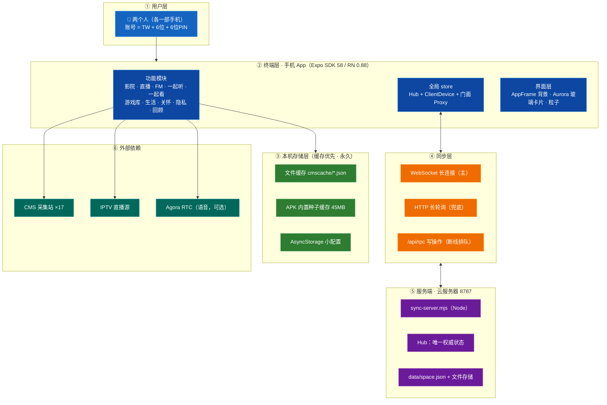

# Mutual 双人空间 · 软件介绍与完整架构原理（详细版）

> 配套图：同目录 `Mutual架构图.png`（高清成图）· `Mutual架构图-扁平.svg`（可编辑矢量）
>
> 目录
> - 第一部分 **软件介绍**：这是什么 / 给谁用 / 怎么开始 / 功能全景 / 体验承诺
> - 第二部分 **总体架构**：五层模型与一次完整数据流
> - 第三部分 **终端层原理**（手机 App）
> - 第四部分 **本机存储层原理**（缓存体系）
> - 第五部分 **同步层原理**
> - 第六部分 **服务端原理**
> - 第七部分 **外部依赖原理**
> - 第八部分 **各功能模块内部原理**
> - 第九部分 **核心数据模型**
> - 第十部分 **一致性与隐私设计原则**
> - 第十一部分 **性能与体验设计**
> - 第十二部分 **质量保障、部署与运维**
> - 附录 **术语表 / 颜色速查 / 常见问题对照**

---

# 第一部分 · 软件介绍

## 1. 这是什么

**Mutual（双人空间）** 是一款只服务**两个人**的私密双人应用。

它不是社交软件，而更像**两个人共同拥有的一间线上屋子**：电影、电视、音乐、听书、游戏、日程、记账、习惯、纪念、情绪、隐私档案，全部放在这间屋子里，只有屋里这两把钥匙能打开。

技术底座：**Expo SDK 58 + React Native 0.88 + TypeScript**，一台自建 Node 同步服务器，APK 包名 `com.twospace.app`。

## 2. 三条产品底线（决定了整个架构）

| 底线 | 含义 | 架构上的落点 |
|---|---|---|
| **只有两个人** | 没有第三人、没有陌生人、没有推荐流、没有广场 | 账号模型是「一人一号 + 互相绑定」，空间成对创建；所有内容都属于这个空间 |
| **没有排行榜** | 不做比较、不做断签惩罚、不搞 KPI | 数据结构里没有 score / rank / streak 惩罚字段；成就只记录"你们达成了" |
| **隐私是默认** | 经期、保险箱、身体数据默认只本人可见，共享要本人逐项打开 | 服务端投影按「角色 + 授权」裁剪；前端拿不到就等于不存在 |

## 3. 谁在用、怎么开始

1. 两个人各自安装 App，各自注册：**账号 = `TW` + 6 位字符 + 6 位登录码**；
2. 一方在「我们 → 绑定」填入对方账号 ID，对方在自己手机上点「同意」；
3. 服务器创建一个**双人空间**（pair），此后两台手机的所有内容都是这份共享状态的一部分；
4. 解绑：任一方发起 → 冷静期 → 双方确认 → 关系解除，双方各自的私密数据按本人选择处理。

## 4. 功能全景

| 模块 | 做什么 | 关键特点 |
|---|---|---|
| 🎬 **影院** | 在线片库（聚合 17 个采集站）+ 详情 + 选集 + 加入一起看 | 缓存优先秒开；分类严格不串档；真实片数统计；同名合并成一张卡 |
| 📺 **电视直播** | 自配 m3u/txt 直播源 → 频道分组合并 → 播放 | 多源合并、坏源标红、支持 `地址\|User-Agent` 请求头、管理权在一个人手里 |
| 📻 **焦焦FM** | 听书 / 电台，多源聚合 | 可跟随对方进度、休眠定时、播放器释放干净 |
| 🎧 **一起听** | 共享音乐队列，两人同步播放 | 全局单播放引擎、暂停不被抢、"同步到这里"一键对齐 |
| 🍿 **一起看** | 同步观影房间：主控/跟随、心跳校准、弹幕、换源、回忆卡 | 一人主控另一人跟随；卡顿才换源；结束时自动生成回忆卡 |
| 🎮 **游戏库** | 内置样例（井字棋/像素沙盒/我们的小窝）+ 粘贴 HTML 游戏 + 原生 APK | 内置游戏双人同步；粘贴的第三方游戏注入联机层（同种子随机 + 输入镜像） |
| 💗 **生活** | 日程、待办、购物、家务、记账、习惯、目标 | 全部双人共享，可认领、可完成、可评论 |
| 🌿 **关怀** | 经期记录与授权、用药/饮水/休息提醒、期望被照顾清单 | 经期默认完全私密，档位授权 + 是否含历史；提醒真正到点弹通知 |
| 🔐 **隐私** | 隐私中心、保险箱、信任与安全报备、授权历史 | 保险箱条目默认不下发明文；每次查看留痕 |
| 🎉 **回顾** | 回忆卡、年度报告、时间轴、月度回顾 | 数据全部来自真实记录，不做假数据 |

## 5. 体验承诺（架构如何兑现）

| 承诺 | 兑现方式 |
|---|---|
| "进片库不用等" | 本地缓存优先铺满，网络只在后台补 |
| "两个人看到同一份" | 服务器 Hub 是唯一权威，客户端只是投影 |
| "点了就有反应" | 本机先乐观执行，再发写操作到服务器 |
| "断网也不崩" | 写操作入队、重连补发；缓存永久有效 |
| "隐私不会漏" | 投影按授权在服务端裁剪 |

---

# 第二部分 · 总体架构

## 6. 五层模型



## 7. 一次完整数据流（用户点了一下"播放"）

```
① 用户点播放
     ↓
② 界面调用 store.play()
     ↓
③ 门面 Proxy：先在本地 Hub 执行（乐观）→ notify → 界面立刻变化
     ↓
④ 同时把 { method:'play', args:[...], token } 发到服务器
     ↓  （WS 已连 → 直接发；未连 → 入队，重连补发）
⑤ 服务器 Hub 校验（房间状态、是否主控…）→ 通过 → revision+1 → 持久化
     ↓
⑥ 服务器把「A 的角色投影」和「B 的角色投影」各推一份
     ↓
⑦ 两台手机 applyRemoteSnapshot → 以服务端为准校准界面
```

关键点：**③ 让体验不等待，⑤⑥⑦ 让两台手机最终一致。**

---

# 第三部分 · 终端层原理（手机 App）

## 8. 代码分层

| 层 | 主要文件 | 职责 |
|---|---|---|
| 入口与外壳 | `app/_layout.tsx`、`ui/AppFrame.tsx` | 路由、统一背景（视频壁纸 + 静态海报兜底）、底部导航、常驻挂件 |
| 页面 | `app/*.tsx`（影院、直播、FM、一起听、一起看、游戏、生活、关怀、隐私…） | 每个页面一个路由，只做"取数据 + 交互" |
| 状态 | `store.tsx` | 全局单例：会话、网络、源配置、房间、音乐、缓存对齐 |
| 领域逻辑 | `core/hub.ts`（空间状态机）、`core/cms.ts`（采集站协议）、`core/liveSource.ts`（m3u 解析）、`core/cinemaClassify.ts`（分类规则）… | 纯函数/纯状态机，可单测 |
| 缓存 | `ui/cmsCache.ts`、`ui/cmsCatCache.ts`、`ui/warmCache.ts` | 四级缓存、分片写、预热与深度缓存 |
| 呈现 | `ui/components.tsx`、`ui/Aurora.tsx`、`ui/MoviePlayer.tsx`、`ui/useMusicEngine.ts`… | 卡片、玻璃、播放器、音乐引擎 |

## 9. 全局 store：一个门面，两种模式

- 内部持有一个**本地 Hub**（可以完全单机运行）；
- 对外暴露一个**门面 Proxy**：
  - **单机模式** → 方法直接调用本地 Hub；
  - **远程模式** → 先在本地执行（乐观，`localEcho` 标记），再 `forwardRpc` 发到服务器。
- 「哪些方法绝不发给服务器」有明确清（`LOCAL_ONLY_HUB_METHODS`），避免把纯本机操作发上去。

这样设计的好处：**同一个界面代码，在"连服务器"和"单机"两种模式下都能跑**，且规则完全一致（因为两端用的是同一份 `hub.ts`）。

## 10. ClientDevice 与播放同步算法

- `ClientDevice` 是"这台设备在状态机里的代表"：播放态、进度、心跳、延迟估计；
- **真实播放器位置每 700ms 回写 store**（`onPosition` → `syncDevicePosition`），
  房间里的 ±10s、暂停、进度显示都用真实值；
- **主控**：每 2 秒心跳上报 `(真实位置, 是否在播)`；服务端以主控为准校准权威位置（偏差 >3 秒才采纳、有 1.5 秒保护期）；
- **跟随方**：目标位置 = `服务端位置 + (当前时间 - 更新时间) × 倍速`；
  - 偏差 >2.5 秒才 seek，两次 seek 至少隔 4 秒（避免每 seek 一次就重拉切片导致"每隔几秒卡一下"）；
  - 服务端位置 <1.5 秒时**不校准**（开局位置还没建立，否则会被拖回 0:00）。

## 11. 服务端权威字段的本地保护

有些字段**只有服务端算得出来**：

| 字段 | 含义 |
|---|---|
| `partnerPeriod` | 对方的经期/关怀状态（含 `careHint`） |
| `recaps` | 房间回忆卡（历史场次） |
| `annual` | 年度报告统计 |
| `partnerOnline` | 对方是否在线 |

本机每次写操作都会把"本地投影"刷到界面，如果不做保护，这四个字段会瞬间变空 → 卡片反复出现/消失。
所以 store 里维护一份「服务端权威缓存」，每次本地投影都把它合并回去（回忆卡取"更完整的那份"）。

## 12. 界面层设计要点

- **背景**：`AppFrame` 统一铺视频壁纸（自定义视频 → 本地缓存 → APK 内置 MP4），底下永远压一张静态海报 → **永不黑屏**；自定义是图片时视频层让位给图片层。
- **玻璃卡片**：`Aurora.Glass`，白度 0.90~0.95（保证"UI 在壁纸之上、看得见"）；背景是视频时自动关闭模糊层（否则每帧重新模糊 → 卡片闪烁 + 耗电）。
- **特效层**：樱花/落叶/雪 + 极光 + 星空 + 流星 + 烟花，全部在内容**之下**，每个子组件 memo，避免每秒重建。
- **性能**：列表虚拟化（`initialNumToRender` / `windowSize` / `removeClippedSubviews`）、store 变更 16ms 合并通知、播放页横屏时隐藏挂件。

---

# 第四部分 · 本机存储层原理（缓存体系）

## 13. 四级优先级

```
① 本机文件缓存（运行期写入，永久有效）
② APK 内置种子缓存（45MB，装完首启就有内容）
③ 网络（实时抓取）
④ 都没有 → 空状态（明确提示，不假装加载）
```

## 14. 为什么用文件而不是 AsyncStorage

安卓 AsyncStorage 默认数据库上限 **6MB**，装不下整库内容。
所以内容缓存全部落成 `documentDirectory/cmscache/` 下的独立 JSON 文件（容量只受手机空间限制）；
AsyncStorage 只保留小配置：账号会话、源列表、已删源名单、通知偏好、已读位置。

## 15. 缓存键与写入粒度（全表）

| 缓存内容 | 键格式 | 粒度 | 谁写 |
|---|---|---|---|
| 单部影片详情 | `vod:<源>\|<id>` | **一条一个文件**（几 KB） | 打开详情页时 |
| 某源整页列表 | `cmsApi:<源>` | 一个文件（≤6000 部） | 预热 / 深度缓存收尾 |
| 某源某页分片 | `cmsApiDeep:p:<源>:<页>` | **一页一个文件**（约 20 部） | 深度缓存，写完不再改 |
| 分片索引 | `cmsApiDeep:i:<源>` | 纯页码数组 + 总数 | 深度缓存 |
| 片库首页 | `lib:home` | 一个文件（合并列表） | 片库第一页加载后 |
| 分类页 | `lib:cat:<档>\|<子类>\|<年>\|<月>` | 一个文件（≤600 部） | 分类/年份/月份切换 |
| 分类原始页 | `mutual_catpage_v1:<源>\|<分类>\|<年>` | 一个文件（带 `at` 时间戳，6h 过期） | 分类抓取 |
| 分类映射 | `mutual_catmap_v1:<源>` | 一个小文件 | 首次拉分类表 |
| 直播台单 | `live:catalog` | 一个文件 | 直播页加载/删源 |
| 测速结果 | `health:live` | 一个小文件 | 手动检测 |

**核心原则：绝不让"一个越来越大的 key"被反复整份覆盖。**
新增内容只写它自己的分片文件，所以写入放大与"库里已有多少存量"无关。

## 16. 原子写（可靠性）

```
写入流程：写 <目标文件>.tmp  →  成功后 move 覆盖正式文件
```

- App 被杀 / 断电 / 进程被系统回收 → 最多丢掉"正在写的那一份"，已有文件永远完整；
- 两个页面同时回填同一部片 → 两个临时文件互不影响，谁最后 move 谁生效，不会写出交叉内容；
- 读取端永远只看到"旧的完整文件"或"新的完整文件"，不存在半截 JSON。

## 17. 增量回填策略（"用得越多，缓存越全"）

1. **新增一个源** → 立刻预缓存该源**前 600 部**（30 页 × 20 部/页），
   限速自适应（连续失败自动放慢，3 次失败即停，下次从上次页码续跑）；
2. **其余条目算"未缓存"** → 不阻塞进库速度，也不假装不存在；
3. **用户点开未缓存的片** → 按 `源 + id` **单条**抓详情（一次请求，不会被限流）→ 写入 `vod:*`，下次秒开；
4. **点「加载更多」/ 切分类 / 切年份** → 只抓当前这一页并写缓存（"加载更多"模式本身不写缓存，避免整类硬拉）；
5. 结论：常用内容自然沉淀在本地，整个库随使用逐步覆盖。

## 18. 片库首屏为什么快

1. 进页面**先读 `lib:home`**（本地文件）→ 列表 + 分类条 + 最近上线轮播一次铺满；
2. 只有在"缓存缺失/页数明显异常（≤1）/数据已很旧"时，才在后台拉一次并静默替换；
3. 分类切换先读该分类缓存（命中即 0 网络），未命中才抓各站对应分类；
4. 所有网络请求都有超时 + 失败兜底，**不会因为一个源慢就让整页空白**。

---

# 第五部分 · 同步层原理

## 19. 身份与握手

- 登录后服务端发 **token**；token 就是身份（客户端不自称 A/B）；
- 长连接建立后立刻 `hello`（带 token、clientId、当前 rev）→ 服务端认出"你是哪个账号、在哪个空间"；
- **重连必须重新 hello**：这是一条新连接，服务端那边的身份是空的，只发 `resume` 不带 token 的话，
  服务端会丢掉后续所有推送（表现为"指示灯绿、Toast 说已重连，但收不到对方更新"）。

## 20. 两条通道

| 通道 | 用途 | 触发条件 |
|---|---|---|
| **WebSocket 长连接** | 主通道：RPC + 服务端推送 | 默认 |
| **HTTP 长轮询 `/api/wait?rev=`** | 兜底：代理/防火墙不支持 WS 时 | WS 握手失败或反复断开 ≥2 次 |

降级是自动的，界面上"已连接"旁边会标出当前是"主地址·长连接"还是"长轮询兼容模式"。

## 21. 写操作（RPC）

- 统一入口 `/api/rpc`：`{ v:1, type:'rpc', id, method, args, token }`；
- **先本机执行，再发服务器**；断线时由连接管理器**入队**（`maxQueue` 限制），重连后补发；
- 同一条写操作**只发一次**（不会"既入队又走 HTTP"导致重复写入）；
- 需要明确结果的操作用 `sendRpcAwait`（8 秒超时），例如"保存源列表"，失败会告诉用户而不是静默；
- 服务端返回 `code:'auth'` 才踢回登录页（其它错误不踢人，避免"网络一抖就莫名退出登录"）。

## 22. 投影（projection）与 revision

- 服务端每次状态变化 → `revision + 1` → 给该空间的**两个角色各生成一份视图**推送；
- 客户端收到后：`hydrateProjected` 还原本地 Hub → 再用服务端原始投影覆盖显示；
- 投影是**按角色裁剪**的：
  - 对方的经期明细？只有授权后才给；
  - 保险箱明文？默认不给，只有本人打开时服务端单独返回；
  - 匿名投票？只给票数和自己那一票；
  - 求婚/婚礼计划？默认对伴侣隐藏（防剧透）。
- **客户端本地那份只是缓存 + 乐观结果**，冲突时永远以服务端为准。

## 23. 断线与状态恢复

```
网络抖动 → 退避重连（2s→4s→8s→16s→30s 封顶）
  → 重连成功 → hello（重新认证）+ resume（补房间与进度）
  → 若 25 秒没收到任何消息：HTTP 自查一次（不掐 socket）
  → 若 90 秒没有任何消息：主动重连
```

写操作在断线期间只是入队，不丢；缓存读取不受影响（离线仍可浏览已缓存内容）。

## 24. 时钟与偏差

- 客户端与服务端做时钟对齐（`clockSync`），房间同步用**服务端时间**计算目标位置；
- 每台设备有独立的延迟/漂移估计（`drift`），房间页会显示"偏差 0.3s·同步良好"这类状态。

---

# 第六部分 · 服务端原理

## 25. 组成

```
sync-server.mjs   Node 18+，零第三方依赖，监听 8787
├─ /ping /health                       健康检查
├─ /api/account/create|login|me        注册 / 登录 / 我的资料
├─ /api/pair/request|accept|decline|reset   绑定流程
├─ /api/rpc                            唯一写操作入口（按方法名调 Hub）
├─ /api/wait                           长轮询（rev 变化即返回）
├─ /api/upload、/api/background/raw     头像/背景/照片/音频/视频上传
├─ /avatar|/background|/photo|/audio|/game  静态文件
└─ data/space.json                     账号 + 配对 + 每个空间完整状态
```

## 26. Hub 是唯一权威

- 所有写操作先过 Hub 校验（权限、状态机、取值范围）→ 通过才 `notify()`：
  ① `revision + 1` ② 给两个角色各推一份投影 ③ 持久化；
- Hub 与客户端用的是**同一份 `hub.ts`**（编译成 `dist-core`），规则天然一致；
- 校验点在服务端，**不是前端**——所以客户端改了代码也没用。

## 27. 持久化与上传

- `data/space.json`：账号、配对、每个空间的 `SpaceState`（当前 16 账号 / 11 空间）；
- 启动时恢复并重建 Hub 实例；每次写操作后落盘（`synchronize` 写临时文件再替换）；
- 文件上传分两条通道：`/api/upload`（头像/照片/背景图/音频）与 `/api/background/raw`（满屏视频背景）；
  两条通道共用 `backgrounds/` 目录，删旧文件时必须**避开仍被状态引用的那一支**。

## 28. 共享配置：一人管理、两人共用

| 配置 | 方法 | 规则 |
|---|---|---|
| 片源接口 | `setCmsApis` | 先配的人是管理者；另一人只读；可显式交接 |
| 直播源 | `setLiveSourceUrls` | 同上（允许清空） |

删除一个源 → 服务端配置更新 → 对方设备收到新列表 → 自动清掉该源在本地的缓存痕迹。
（这就是"我删了，对方那边也跟着消失"的机制。）

## 29. 可观测性

每个写操作留一行日志：

```
[rpc] 账号=TWABC123 空间=pair_TWABC123 方法=setLiveSourceUrls ok rev=6460632
```

排查顺序固定：**服务端有没有收到 → 有没有生效（ok/rev）→ 再看客户端投影**。
服务端也会把"解绑收尾、上传异常"等关键动作写日志。

---

# 第七部分 · 外部依赖原理

## 30. CMS 采集站（片库来源）

### 协议三件套

| 请求 | 用途 | 返回 |
|---|---|---|
| `?ac=list` | 分类表（含各站自己的分类 id、层级） | `{ class:[{type_id,type_name,type_pid}] }` |
| `?ac=video&pg=N` | 第 N 页列表（每页 20 条） | `{ page, pagecount, total, list:[…] }` |
| `?ac=detail&ids=<id>` | 单部详情（含播放线路） | `{ list:[{vod_play_url,vod_play_from,…}] }` |

### 三个必须处理的现实问题

1. **分类 id 是各站自己编号的**
   → 分类必须按**名字**逐站对齐（不能拿 A 站 id 去问 B 站），且要做**同义词归并**：
   `日韩动漫 ≈ 日本动漫`、`国产动漫 ≈ 中国动漫`、`动漫电影 ≠ 动漫`。
2. **`vod_id` 也可能重号**
   → 详情缓存键必须带源；列表侧按片名去重合并成一张卡；没带源时不吃缓存，按主源重新单条抓。
3. **`total/pagecount` 可能虚高**
   → App 不把"各站自报行数相加"当片数；真实片数来自一次全量统计（见下）。

### 实测规模（全量抓取 + 去重）

| 指标 | 数值 |
|---|---|
| 可用采集站 | **17 个**（另有 3 个失效：`xgzyapi` 404、`apiyhzy` / `jszyapi` 超时） |
| 抓取行数 | 1,377,556 行 |
| **按片名去重后** | **280,170 部** |
| 动漫 / 日韩动漫 / 国产动漫 / 欧美动漫 | 29,018 / 9,897 / 8,936 / 1,724 |
| 电影 / 剧集 | 98,304 / 110,527 |

（重复率约 80%——各站互相搬运同一批资源，所以"行数相加"会虚高数倍。）

### 分类严格性规则（片库不乱档）

- 采集站分类标错很常见（恐怖片跑到"电影"、2012 的剧跑到"2026 爱情片"），所以做**桶校验**：
  `filterByBucket` 按类型把明显不属于这一档的条目剔掉（宁可少几部，也不脏）；
- 「…片 / …篇」优先判为电影，「剧」才判剧集（避免"剧情片/喜剧片"被当成剧集）；
- 动漫桶额外做真人过滤（`smartFilterAnime`），并提示"剔掉了几部真人内容"；
- 年份筛选要求**精确匹配**（拿不到年份的条目不算这一年，避免旧片混进新年份）；
- 月份筛选**只在已缓存列表里过滤**，点一下不发网络请求（所以秒出）。

## 31. IPTV 直播源

- 支持 **m3u / m3u8 / txt** 三种格式；txt 的 `分组,#genre#` 写法同样支持；
- 常见写法 `http://ip/live.m3u8|User-Agent=FongMi|Referer=…`：
  `|` 后面部分会被**拆成 HTTP 请求头**交给播放器（否则服务端 403、界面黑屏）；
- 多源合并成一份台单：同名频道合并备用线路，某个源挂了在界面上明确标红并给出原因；
- 删除源后，该源在台单里的频道与红色报错会一起消失（不会"删了还在"）。

## 32. Agora RTC（语音，可选）

- 只是"两人语音"这一条能力，信令走自己的同步层（邀请/同意/拒绝/结束）；
- **静音 / 扬声器 / 音量按本人当前偏好**应用到引擎，进频道后再应用一次；
- 结束后 `leaveChannel + release`，不会泄漏原生引擎；
- 全程不录音、不存档。

---

# 第八部分 · 各功能模块内部原理

## 33. 影院（片库 → 详情 → 播放 → 一起看）

```
进片库 → 读 lib:home（秒开）→ 需要时后台刷新
   ↓ 点分类/年份/月
读分类缓存 → 未命中 → 各站按名字对齐分类 id → 抓第一页 → 合并去重 → 写缓存
   ↓ 点一部片
读 vod:<源>|<id>（命中即秒开）→ 未命中 → 按 id 单条抓详情 → 写缓存
   ↓ 播放
多条线路测速 → 选最快 → 播放器加载 → 失败自动换源
   ↓ 一起看
加入共享队列 → 创建/加入房间 → 主控播放，跟随方同步
```

## 34. 一起看房间（状态机）

```
CREATED → PREPARING（双方就绪）→ COUNTDOWN（倒计时）→ PLAYING ⇄ PAUSED
        → ENDED（结束）→ RECAP（回忆卡保存）→ DISSOLVED
        ↘ EXPIRED（邀请过期）
```

- **主控制**：只有主控能改进度/倍速；跟随方点"播放/暂停"是**申请**，由主控执行；
- **心跳校准**：主控 2 秒一次上报真实位置；服务端偏差 >3 秒才采纳，并有 1.5 秒保护期；
- **卡顿换源**：只在"已就绪且确实在播"时才记卡顿（避免起播阶段被误判 → 自动换源死循环）；
- **房间队列常驻**：房间内可直接选集/加片/换片，不用退出房间；
- **结束生成回忆卡**：片名、时长、双方评分、一句话短评 → 进「我们的片单」。

## 35. 一起听（单引擎 + 同步）

- 全局只有**一个**播放引擎实例（`useMusicEngine` 挂在 AppFrame），所有页面共享；
- 服务端保存队列 + 当前曲目 + 进度 + 播放状态（`music.action/index/positionSec/seq`）；
- 谁操作谁写入，另一方跟随；**"↻ 同步到这里"** = 以我当前这一秒为准，对方立刻跳过来；
- 音频焦点统一登记：FM/试听/音乐争用时按"谁主动播谁赢"，被抢的一方自动让路（不会两段音频叠着响）；
- 队列被删空 → 引擎立即停止并释放（不会"声音继续放但界面没有停止键"）。

## 36. 焦焦FM

- 多源聚合（每个源一个 xml/json index），断源可切换；
- 播放列表页与播放页之间**交接进度**（进播放页先 seek 再播，不会两路同时响）；
- 换集/离开页面会 `remove()` 掉旧的原生播放器（避免多路 AudioTrack 累积）；
- 支持"跟随对方进度"（可选开关）与休眠定时。

## 37. 游戏库

- **内置样例**（井字棋 / 像素沙盒 / 我们的小窝）：跑在 WebView 里，双人同步靠 `gameSession.state + seq`；
- **粘贴的第三方 HTML 游戏**：注入**联机层**（同种子随机数 + 输入镜像 + 局面镜像），
  通道是 `TW_NET:` 前缀消息 → App → Hub → 对方 WebView 的 `TwNet.applyRemote`；
- **原生 APK 游戏**：上传/云编译后按包名打开已安装版本；
- 农场/沙盒这类"世界存档"上限放宽到 2MB，服务端只存储和广播，不在服务端执行陌生代码。

## 38. 生活与关怀

- 日程/待办/购物/家务/记账/习惯/目标：都是双人共享条目，可认领、可完成、可评论；
- **经期**：记录只本人可写；**授权档位**（private / care / summary / full）+ **是否含历史**；
  伴侣看到的永远是"按档位裁剪后的投影"，看不到未授权内容；
- **计划记录**：默认仅本人可见，本人可一键"共享给 TA / 撤回"（与经期档位无关）；
- **提醒**（用药/饮水/休息）：存下来后**真的会到点弹系统通知**（本机每分钟检查，当天去重，免打扰时段按设置）。

## 39. 隐私与安全

- **隐私中心**：一眼看到"当前 TA 能看到什么"；
- **保险箱**：条目默认不下发明文；被授权人查看时由服务端**单独返回**明文并留痕（谁在什么时候看过）；
- **信任与安全报备**：位置共享是单次授权、有到期时间，不做长期轨迹；
- **授权历史**：每次档位变化都记一条（谁、从什么改到什么、是否含历史）；
- **通知**：可设免打扰时段、锁屏是否显示内容。

## 40. 回顾

- **回忆卡**：每场一起看结束生成一张（片名/时长/评分/短评）；
- **年度报告**：按**当年**统计（电影场次、类型分布、感谢卡、目标完成、旅行、纪念日、高频词）；
- **时间轴/月度回顾**：只读真实记录，不生成假数据。

---

# 第九部分 · 核心数据模型

服务端为每个双人空间保存一份 `SpaceState`，客户端看到的是按角色裁剪后的投影。

```
身份与关系   spaceId / boundAt / members[A,B] / invite / bindRequest
生活         todos / events / shopping / chores / ledger / habits / goals
关怀与隐私   period[A,B]{ tier, shareHistoryFrom, sharePlanLog, planLog }
             careReminders / comfort / giftIdeas / trust / vault / safety
回忆与回顾   rooms{ recap } / collection / cards / diary / timeline / annual
一起看/听    activeRoom / watchQueue / music{ queue,index,action,positionSec,seq }
游戏         games / gameSession{ state,seq,net,netSeq } / voxelWorld / voxelMods
配置         cms{ apis,manager } / live{ urls,manager } / decor / pet / themes
同步与痕迹   activity（对方动态）/ notifications / audit（授权与关键动作）
```

设计要点：

- **没有排行/比较字段**；
- **授权类字段都挂在本人名下**（`period[role].tier`、`sharePlanLog`、`vault.granted`），别人改不了；
- **`rooms` 保留历史**（回忆卡、年度报告都从它统计），不会因为重连被清空；
- **`gameSession.net`** 是第三方游戏的联机通道（只保留最新一个包，避免快照膨胀）。

---

# 第十部分 · 一致性与隐私设计原则

| 原则 | 具体做法 |
|---|---|
| **服务端权威** | 共享状态由 Hub 决定；客户端只做乐观预演 |
| **乐观但可校准** | 本机立即生效；服务端投影到达后校准；短时间内用"乐观窗口"避免界面倒退 |
| **删除要穿透** | 删源/删接口 → 服务端配置 + 本机缓存痕迹 + 对方设备缓存 三处一起清 |
| **写不外泄** | 投影按角色裁剪；保险箱明文不进投影，只在本人打开时单独返回并留痕 |
| **匿名即真匿名** | 匿名投票只下发各选项票数 + 自己那一票，对方的票不下发 |
| **文件不半截** | 所有缓存写入走 `.tmp + move` 原子替换 |
| **只发一次** | 断线时入队，不同时发 HTTP（避免重复写入） |
| **解绑即解除** | 双方确认后服务端同时回收账号层关系与状态层数据，之后可重新绑定 |
| **冷热分离** | 热数据（列表/详情）进缓存；冷数据（历史记录）只留在服务端 |

---

# 第十一部分 · 性能与体验设计

| 目标 | 手段 |
|---|---|
| **进片库快** | 缓存优先铺满；后台静默刷新；首页失败也有种子缓存兜底 |
| **翻页快** | 分类/分页缓存 + 只抓当前页；常用分类常驻本地；月份筛选纯本地过滤 |
| **播放稳** | 单一播放器；卡顿才换源；心跳校准带阈值与冷却；换源保留进度 |
| **不卡顿** | 列表虚拟化；特效子组件 memo；store 通知 16ms 合并；避免每秒重建大对象 |
| **省流量** | 缓存命中不发请求；预热有上限；分片写不重复覆盖；`CacheWarmer` 只在"源指纹变化"时跑 |
| **省电** | 视频背景下关闭卡片模糊；粒子在内容之下且数量受控；后台不做无意义轮询 |
| **永不黑屏** | 内置壁纸 MP4 + 静态海报兜底；播放器错误不删本地缓存 |

---

# 第十二部分 · 质量保障、部署与运维

## 41. 测试与质量门

- **单元测试 520 个全过**：Hub 状态机、分类规则、缓存对齐、直播解析、音乐同步、WS 端到端等；
- **TypeScript 严格模式**：App 与 core 两套 `tsconfig` 均零错误；
- **服务端语法/启动自检**：`node --check` + 启动日志（恢复账号/空间数量）。

## 42. 构建

```
cd android
gradlew :app:assembleRelease -PuniversalApk
→ Mutual-vX-universal.apk（约 260MB，含 45MB 种子缓存与全部资源）
```

## 43. 服务端部署

```
scp dist-core/*.js  server/sync-server.mjs  →  /home/admin/twospace/
PORT=8787 HOST=0.0.0.0 nohup node server/sync-server.mjs &
```

## 44. 日常排查顺序

1. 服务端日志 `[rpc] 账号=… 方法=… ok/失败 rev=…`：**有没有收到、有没有生效**；
2. 客户端「我们 → 诊断」：服务端地址、背景视频状态、对方在线状态、房间播放读数；
3. 缓存：`我们 → 存储` 看缓存文件数量与大小（分片是一页一个文件）。

---

# 附录

## A. 术语表

| 术语 | 含义 |
|---|---|
| **Hub** | 空间状态机，所有写操作的唯一入口与权威 |
| **投影 projection** | 服务端按角色裁剪后推给客户端的视图 |
| **revision（rev）** | 状态版本号，每次写操作 +1，用于推送与去重 |
| **乐观更新** | 先在本地执行、界面立刻生效，再发服务器 |
| **门面 Proxy** | store 里包裹本地 Hub 的代理层，决定"本地执行 + 是否转发服务器" |
| **分片（shard）** | 一页一个缓存文件，避免大 key 反复覆盖 |
| **原子写** | 先写 `.tmp` 再 move 覆盖，保证不出现半截文件 |
| **种子缓存** | 打包在 APK 里的 45MB 缓存，首启即有内容 |
| **源指纹** | 片源接口 + 直播源 + FM 源的哈希，用于判断"要不要重新预热" |
| **主控 / 跟随** | 一起看房间里的两种角色，进度由主控决定 |

## B. 颜色速查（与架构图对应）

| 颜色 | 层 | 包含 |
|---|---|---|
| 🔵 蓝 | 终端层 | 功能模块、全局 store、UI 层、播放器 |
| 🟢 绿 | 本机存储 | 文件缓存、分片缓存、种子缓存、原子写、AsyncStorage |
| 🟠 橙 | 同步层 | WS 长连接、HTTP 长轮询、RPC 队列、投影、缓存策略 |
| 🟣 紫 | 服务端 | sync-server、Hub 权威状态、space.json、文件存储、共享配置 |
| 🟦 青 | 外部依赖 | CMS 采集站、IPTV、Agora RTC |

## C. 常见疑问对照

| 疑问 | 答案 |
|---|---|
| 为什么片库数字和"各站自报相加"不一样？ | 自报是"行数"，各站互相搬运重复率高；真实片数是**按片名去重**后的 280,170 部 |
| 为什么分类里某些片子会少？ | 分类严格校验会剔掉明显不属于该档的条目（宁少不脏）；年份筛选要求精确匹配 |
| 为什么新增源只有 600 部？ | 600 是"立刻可用"的预热档；其余按需回填——你点开哪部就缓存哪部，翻页就缓存那一页 |
| 换手机/重装会丢缓存吗？ | 本地缓存会重建；**共享数据（日记/房间/回忆）都在服务器**，登录即恢复 |
| 断网了还能看吗？ | 已缓存的片库、已缓存的详情/播放源可以；房间同步需要网络 |
| 对方能看到我的经期吗？ | 默认不能。只有你打开档位授权（并可选择是否含历史）后，按档位裁剪后可见 |
| 保险箱内容存在服务器吗？ | 存在，但**不进投影**；只有本人（或被授权人）打开时由服务端单独返回明文，并留痕 |

---

# 第十三部分 · 全部模块逐一原理

> 前面几部分把高频模块写细了，这一部分把**每一个功能模块**的"数据怎么存、谁能改、怎么同步、界面看到什么"逐条补齐。
> 分组与代码里的 Hub（纯 TS 空间状态机，220 个公开方法）一致。

## 45. 账号与关系

### 45.1 注册 / 登录
- 账号 = `TW` + 6 位 + 6 位登录码；服务端保存账号记录（昵称、性别、生日、头像、绑定关系）；
- 登录成功发 **token**；此后所有请求带 token，**服务端靠 token 认人**（客户端不自称 A/B）；
- 换手机只需重新登录：共享数据在服务器，本地缓存重建。

### 45.2 绑定（pair）
```
A 填 B 的账号 ID → 服务端校验（存在 / 不是自己 / 对方没有已绑空间）
  → 生成绑定请求 → B 手机上出现「TA 想和你绑定」
  → B 同意 → 服务端创建 pair（a / b / boundAt）→ 两人槽位就位 → 双方各拿到一份投影
```
- **账号层（pair）与状态层（SpaceState）是两套**，解绑时服务端必须同时收尾，否则"解绑了却绑不回来"；
- 一个账号同时只能在一个空间里（服务端强制）。

### 45.3 解绑（unbind）
```
任一方 requestUnbind(choice) → 进入冷静期（coolingEndsAt）
  → 双方都可 setUnbindChoice 改"我的数据怎么办"（保留副本 / 全部删除）
  → 冷静期结束后双方 confirmUnbind → 关系解除 + 数据按各自选择处理
  → 服务端同时回收账号层 pair，两人各回个人空间（之后可重新绑定）
```
- 「删除全部数据」会连**痕迹**一起清：活动流、通知、审计、评论、一起看队列、房间回忆、游戏存档、宠物装扮、上传的背景图；
- 冷静期**真的会校验**（未到期确认不生效），期间可随时撤销。

### 45.4 身份校正
客户端用"我的账号 ID 在哪一格"确定角色；服务端每份投影都带 role。
槽位变化时（被绑进对方空间）会自动校正，避免"把对方档案显示成自己"。

## 46. 日程 / 待办 / 购物 / 家务

| 模块 | 结构要点 | 规则与原理 |
|---|---|---|
| **日程 events** | `{id,title,startMin,endMin,dateBy?}` | 新增/修改**先校验再写入**（结束必须晚于开始），失败不落库 |
| **待办 todos** | `{id,title,assignee,dueDate,done}` | assignee 可为 A/B/either；可勾选完成、可指派；完成态实时同步 |
| **购物 shopping** | `{id,name,qty,done}` | 可单条勾选，也可"清空已完成"（批量） |
| **家务 chores** | `{id,name,assignee,current,completedBy,history}` | **认领制**：谁认领归谁；完成可撤销；历史保留"谁在什么时候做完" |

同步方式统一：写操作过 Hub 校验 → `notify`（rev+1）→ 双方投影更新。这些条目都属于空间，不做"只我可见"。

## 47. 记账

- 结构：`{id,title,amountCents,payerRole,split,date,confirmed}`；
- **金额以"分"为整数存**（避免浮点误差）；
- `confirmLedger` 双方确认后视为已结算；`ledgerBalance` 按 payer + 分摊计算"谁欠谁多少"；
- 界面只展示"我付的 / TA 付的 / 当前谁欠谁"，不做排行榜、不做月度评分。

## 48. 习惯 / 目标

| 模块 | 结构 | 原理 |
|---|---|---|
| **习惯 habits** | `{id,name,days:boolean[]}` | 打卡是**记录**不是考核：可打可撤、不做断签惩罚、不做排行榜；`cheerHabit` 只是给对方一句鼓励 |
| **目标 goals** | `{id,title,target,current,done,contributors}` | 双人**共同进度**：任一方 `contributeGoal` 累加；达成后 `completeGoal` 记一笔"你们完成了" |

## 49. 情绪 / 每日一问 / 卡片 / 日记 / 周复盘 / 时间轴

### 49.1 情绪（moods）
- `moods[A,B]` 各存一条当前心情（晴 / 多云 / 小雨 / 需要抱抱）+ 一句话；
- **只显示对方此刻愿意公开的那一句**，不堆历史（避免被当成情绪监控）；
- 「抱抱」是独立动作（`hugBack`），不要求回应。

### 49.2 每日一问（dailyQuestion）
- 题库按天轮换；**双方都答完才互相可见**（数据结构保证：未答完时对方答案是 undefined）；
- 答案不进任何统计或排行榜。

### 49.3 卡片（cards）
- 类型：感谢卡 / 夸夸卡 / 冷静卡（冲突时用）；
- 生命周期：`sendCard → replyCard → acceptCard`；
- 卡片正文会进活动流，但**只带中性摘要**；有回应状态，能知道"对方看到了"。

### 49.4 双人日记（diary）
- 结构：`{id,date,entries:{A?,B?}}` —— **一篇日记两个段落**，各写自己那段；
- 只有本人能改自己那段（`editDiaryEntry` 校验 byRole）；
- 默认双方可见；删数据时整篇清空。

### 49.5 周复盘（weeklyReviews）
- 三问分别记录（这周最开心 / 最难 / 下周想一起做什么），双方各答，按周归档，不打分。

### 49.6 时间轴（timeline）
- `{id,title,at,kind,byRole}`，按日期排序展示"你们的共同历程"；
- 写入来源多样（纪念日、房间结束、里程碑），但**只追加、不覆盖**。

## 50. 收藏 / 一起选片 / 预约观影 / 异地 / 婚礼 / 装扮 / 宠物 / 主题

### 50.1 收藏（collection）
- 多用途集合：`{id,kind,title,tags,meta,visibility,ownerRole,votes,claimed}`；
- `kind`：movieList / trip / milestone / playlist / photoMemory / wishJar …；
- **visibility**：`shared`（双方可见）或 `owner`（仅本人）；
- `collectionVote` 记双方"喜欢"（一起选片的输入）；`collectionClaim` 表示"这件事我认领"。

### 50.2 一起选片（pickSession）
- 开一场选片会话 → 各自 `pickMovie` → `pickMatches` 返回**双方都 like** 的片；
- 只取交集，不搞"少数服从多数"（两个人的事）。

### 50.3 预约观影（watchPlans）
- `{id,title,date,status}`：一方提出 → 另一方 `confirmWatchPlan` → 写入共享日历；
- 未确认的计划只有发起方能看到细节。

### 50.4 异地模式（ldr）
- `{enabled,nextMeetDate,ticket,budgetCents,checklist}`：开关 + 下次见面 + 车票 + 预算 + 清单；
- 纯记录，不推送"你多久没见面"这类压力型提醒。

### 50.5 婚礼 / 求婚计划（wedding）
- 默认**仅自己可见（防剧透）**，本人 `shareWedding(true)` 后伴侣才看到；
- 首次写入者成为 owner；预算 / 风格 / 宾客 / 候选日期四块。

### 50.6 装扮（decor）/ 宠物（pet）/ 主题（themes）
- **decor**：`{slots: Record<位置, 物品id>, updatedBy}` —— 小屋挂件布局，双方都能改、实时同步；
- **pet**：`{name,water,food,affection,careDays,lastCareDay}`；`petCare(water/feed/pet)` 增加好感与照料天数；
  记**累计照料天数**而非连续天数，刻意不做断签惩罚；
- **themes**：`{id,byRole}` —— 双方各自选的主题，界面按当前角色渲染。

## 51. 关怀（经期 / 期望清单 / 提醒 / 关心动作）

### 51.1 经期记录与授权
```
本人 addPeriodRecord / updatePeriodRecord / deletePeriodRecord   ← 只有本人能写
本人 setPeriodTier(tier, shareHistory)                          ← 授权档位
  private → 完全不可见
  care    → 只给"今天需要关心吗"这类中性提示（careHint）
  summary → 给周期摘要（不逐条）
  full    → 给明细（是否含历史由 shareHistory 决定）
伴侣侧 partnerPeriod = 服务端按档位裁剪后的投影（拿不到就是拿不到）
```
- `revokeAllConsent` 一键撤回全部授权（档位打回 private）；
- **授权历史** `tierHistory`：每次变化都记"谁、从什么改到什么、是否含历史"——这是隐私模块唯一给用户看的证据链；
- 预测开关（`togglePeriodPrediction`）只是本人可见，不产生医疗建议。

### 51.2 期望被照顾清单（comfort）
- 本人写、本人删；伴侣**只能看和照做**，不能替你改；
- 不预置模板（第一条必须自己写）；
- `sendCareAction` 照着清单做一次 → 对方收到一条中性通知。

### 51.3 提醒（careReminders）
- `{id,ownerRole,kind,time('HH:mm'),enabled,note,visibleToPartner}`；
- **真正到点弹系统通知**：本机每分钟比一次 HH:mm，当天去重，只提醒自己设的；
- 免打扰时段按设置（自设提醒默认放行，因为是本人要求的）。

### 51.4 关心动作
- `nudgePartner` / `cheerHabit`：只发轻量提示，不带任何健康数据；
- 通知文案固定中性（如"TA 完成了小屋宠物：浇水"）。

## 52. 隐私中心 / 保险箱 / 信任 / 亲密卡 / 社会报备

### 52.1 隐私中心
- 汇总"当前 TA 能看到什么"：经期档位、计划记录共享、保险箱授权；
- 读的是**按角色裁剪的投影**，不是前端遮挡。

### 52.2 保险箱（vault）
```
addVaultItem(label, secret)      ← 明文只存在服务端状态，列表投影**不带 secret**
grantVaultAccess / revokeVaultAccess  ← 所有者授权 / 撤回
openVaultItem(id)                ← 本人或被授权人打开 → 服务端单独返回明文 + 记一次 views（谁、何时）
```
- 列表永远不透明文；每次查看留痕，这就是"查看记录"。

### 52.3 信任与安全（trust / safety）
- 位置共享是**单次授权**：`startLocationOnce` 给一个到期时间，不做长期轨迹；
- `requestArrived`：安全到家报备（一次性中性通知）；
- `safety` 记录关键安全动作，只追加。

### 52.4 亲密卡 / 社会报备
- 亲密卡：本人创建、**可选择性共享**（默认不共享给伴侣），可删除；
- 社会报备：本人写、本人撤回（撤回后对方不可见）。

## 53. 一起听 / FM 的同步细节

- **音乐状态**：`{queue,index,action,positionSec,updatedAtServerMs,seq,loop,shuffle,updatedBy}`；
- 谁操作谁写入：`musicAction(play/pause/seek/change_track/setting)`，另一方按 `seq` 跟随；
- **防回声**：自己的动作不回灌（靠 `updatedBy` + `seq`）；
- 队列为空时 `play/pause` 直接失败（提示"队列里还没有歌"），避免服务端一直停在 play；
- FM：`fmSources`（源列表，空间级）+ `fmProgress`（当前集 / 进度 / 是否在播），可开"跟随对方"；
  页面间交接时先 seek 再播，避免同一集两路叠着响。

## 54. 一起看 / 弹幕 / 语音 / 场景

- **房间**：见第 34 节状态机；还有 `mediaOffset`（每台设备的音频延迟补偿）、`playbackRate`（主控可调）、`holdUntil`（刚操作后的保护期）；
- **弹幕**：带 `mediaPosSec + sourceUrl`，换片时旧弹幕钉在旧地址上（不串台）；
- **表情反应**：轻量、不落长历史；
- **语音**：`startVoiceInvite / accept / decline / setMuted / setSpeaker / setVolume / switchToTextOnly / endVoice`；状态机在服务端，RTC 只负责音频通道；
- **场景**：爆米花 / 猫 / 毯子这类虚拟影院布置，双方可切换、实时同步；
- **评分与短评**：房间结束时写入回忆卡。

## 55. 游戏（三种形态 + 联机层）

| 形态 | 数据 | 同步方式 |
|---|---|---|
| 内置样例（井字棋 / 沙盒 / 小窝） | `gameSession.state`（JSON，上限 2MB） | `pushGameState` + `seq`，对方注入 WebView |
| 粘贴的第三方 HTML | 同上 + `net / netSeq / netFrom` | 注入联机层：同种子随机 + 输入镜像，包走 `TW_NET:` |
| 原生 APK 游戏 | `games[].assetPath / packageName` | 各自本地运行，局面按需同步 |

- **开局**：库里有的用 `startGame`，内置样例用 `startSampleGame`（样例不进游戏库）；
- **存档**：同一游戏再次打开 = 继续这一局（不重置世界）；`endGame` 结束本局；
- **体素世界**：`voxelWorld.edits` 记录改过的格子（x,y,z,方块id），支持合并 / 撤销 / 清空；
  服务端**只存不执行**，安全边界清晰。

## 56. 影院侧：队列 / 片源 / 直播源

- **一起看队列**：双人共享待看清单 `{id,title,episodeName,url,byRole}`；可单条删、可清空；
  点一条 `playFromQueue` = 换片并从头播（房间已散会则新建房间）；
- **片源接口（cms）**：`{apis[],manager,updatedAt}` —— 一人管理、两人共用；删除会清本地与对方缓存痕迹；
- **直播源（live）**：同上，允许清空（空 = 电视直播页空状态，不是错误）。

## 57. 回顾类：回忆卡 / 年度报告 / 里程碑

- **回忆卡**：房间 `ENDED` 后 `saveRecap` 写入 `rooms[id].recap`（片名 / 时长 / 评分 / 短评 / 截图最多 3 张）；
- 房间历史**永不清除**，所以"一起看完 N 部"的成就与年度报告都从它统计；
- **年度报告**：按**当年**切片统计电影场次、类型分布、感谢卡、目标完成、旅行、纪念日、高频词；
- **里程碑**：手动或自动追加，只增不删。

## 58. 通知与动态（跨越所有模块）

```
某模块写操作 → Hub.logActivity(标题截断 18 字) + pushNotification(中性文案)
   ↓
服务端投影里的 activity（只下发"对方的"动作）
   ↓
客户端 announcePartnerActivity：按"已读位置 + 本次进程已提示集合"去重
   ↓
界面：顶部提示卡 + 可选系统通知（遵守免打扰 / 锁屏设置）
```
- 文案原则：**只描述动作，不带内容细节**（"TA 新增了日记"，不说写了什么）；
- 免打扰时段不弹系统通知，但 App 内提示卡照常；
- 同一批动态在本次打开 App 期间只提示一次。

## 59. 背景 / 壁纸 / 上传

- **自定义满屏背景**：图片走 `setBackground`（`/api/upload`），视频走 `setCustomBackground`（`/api/background/raw`，并生成 poster 静态图）；
- 客户端优先本地缓存文件 → 服务器地址 → APK 内置壁纸，**永远有一层静态海报兜底**（不会黑屏）；
- 头像 / 照片 / 音频同理：先上传拿相对路径，再登记进状态；
- 服务端删旧文件时**避开仍被状态引用的那一支**（否则会把正在用的背景删掉）。

## 60. 模块与 Hub 方法对照速查

| 领域 | 代表方法 |
|---|---|
| 账号关系 | `requestBind / acceptBind / declineBind`、`requestUnbind / setUnbindChoice / cancelUnbind / confirmUnbind` |
| 日程待办 | `addEvent / updateEvent / deleteEvent`、`addTodo / toggleTodo / setTodoAssignee`、`addShopping / toggleShopping / clearDoneShopping` |
| 家务记账 | `addChore / claimChore / completeChore`、`addLedger / confirmLedger / ledgerBalance` |
| 习惯目标 | `addHabit / toggleHabit / cheerHabit`、`addGoal / contributeGoal / completeGoal` |
| 情绪卡片 | `setMood / hugBack`、`sendCard / replyCard / acceptCard`、`ensureDailyQuestion / answerDailyQuestion` |
| 日记回顾 | `addDiaryEntry / editDiaryEntry`、`submitWeeklyReview`、`addTimelineNode` |
| 关怀 | `addPeriodRecord / setPeriodTier / revokeAllConsent`、`addPlanEntry / togglePlanLogShare`、`addCareReminder / toggleCareReminder`、`addComfortItem / sendCareAction` |
| 隐私 | `addVaultItem / grantVaultAccess / revokeVaultAccess / openVaultItem`、`setTrust / startLocationOnce / requestArrived`、`addIntimacyCard / shareIntimacyCard`、`addSocialReport / withdrawSocialReport` |
| 一起看 | `createRoom / setReady / joinRoomByCode / approveJoinRoom`、`play / pause / seek / heartbeat / transferLeader`、`sendDanmaku / sendReaction / rateMovie / saveRecap / endRoom` |
| 一起听 | `addMusicTrack / removeMusicTrack / musicAction`、`addFmSource / pushFmProgress` |
| 影院直播 | `addWatchQueue / playFromQueue / setRoomSource`、`setCmsApis / transferCmsManager`、`setLiveSourceUrls / transferLiveManager` |
| 游戏 | `addGame / startGame / startSampleGame / pushGameState / pushGameNet / endGame`、`applyVoxelMod / mergeVoxelEdits` |
| 其他 | `collectionAdd / collectionVote / collectionClaim`、`addWatchPlan / confirmWatchPlan`、`startPickSession / pickMovie / pickMatches`、`setLdr`、`updateWedding / shareWedding`、`decorate / petCare / setTheme` |
